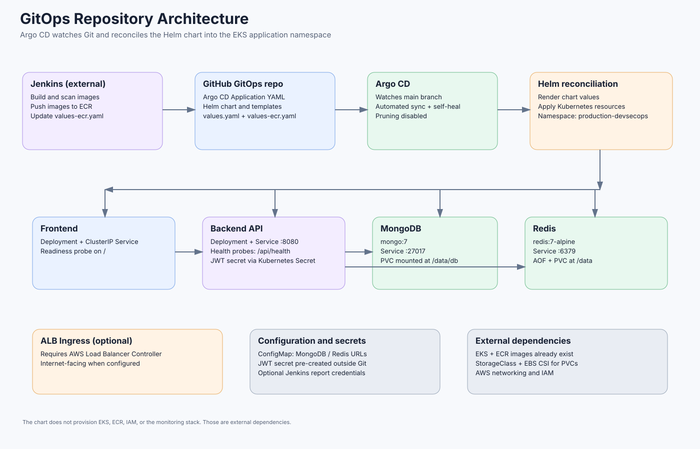

# Production DevSecOps GitOps

GitOps source repository for the **Production DevSecOps Platform**. It defines the Argo CD Application, Helm chart, Kubernetes resources, image references, persistent storage claims, and ALB Ingress used to deploy the frontend/backend application and its MongoDB/Redis services to Amazon EKS.

> **Current status:** This repository was used to deploy the application to EKS. The AWS infrastructure has since been torn down to avoid ongoing costs. The repository is configuration/source, not evidence of a currently running cluster.

## Architecture



For the complete flow from code commit through CI, ECR, Argo CD, EKS, and monitoring, see [End-to-end architecture](docs/Architecture/end-to-end-architecture.svg).

## What lives here

```text
.
├── argocd/
│   └── production-devsecops-platform.yaml   # Argo CD Application
├── apps/production-devsecops-platform/
│   ├── Chart.yaml                           # Helm chart metadata
│   ├── values.yaml                          # Application and service defaults
│   ├── values-ecr.yaml                      # Current image refs; Jenkins updates this
│   ├── values-ecr.yaml.example              # Safe template for image refs
│   └── templates/
│       ├── platform.yaml                    # ConfigMap, PVCs, Deployments, Services
│       └── ingress.yaml                     # Optional ALB Ingress
└── scripts/
    └── validate-image-values.sh             # Rejects placeholder image values
```

## Runtime components

- **Frontend:** React app served by the frontend container on port 80.
- **Backend:** Express API on port 8080; uses `/api/health` for readiness/liveness probes.
- **MongoDB:** `mongo:7`, exposed internally through a ClusterIP Service, with a PVC for `/data/db`.
- **Redis:** `redis:7-alpine`, configured with append-only persistence and a PVC for `/data`.
- **Configuration:** `platform-config` ConfigMap provides runtime mode, port, MongoDB URI, and Redis URL.
- **Secrets:** the chart expects a pre-created `production-devsecops-secrets` Secret containing `JWT_SECRET`; optional Jenkins-report credentials can be provided separately.
- **Ingress:** an ALB Ingress can be enabled using `ingress.enabled`; it requires the AWS Load Balancer Controller and suitable AWS networking/IAM configuration.
- **GitOps:** the Argo CD Application targets branch `main`, chart path `apps/production-devsecops-platform`, namespace `production-devsecops`, with automated sync and self-heal enabled. Automated pruning is disabled (`prune: false`).

## End-to-end GitOps flow

1. Jenkins builds and scans backend/frontend images in the application repository.
2. On the `main` branch, Jenkins pushes versioned images to ECR.
3. Jenkins updates `apps/production-devsecops-platform/values-ecr.yaml` with the new ECR image names and commit-derived tag, runs `scripts/validate-image-values.sh`, commits, and pushes the change.
4. Argo CD observes the GitOps commit and renders the Helm chart using `values.yaml` plus `values-ecr.yaml`.
5. Argo CD applies the rendered resources to the `production-devsecops` namespace in EKS.
6. Kubernetes starts the pods and services. The frontend Ingress provisions an ALB when ingress is enabled and the AWS Load Balancer Controller is available.

## Prerequisites for a future deployment

- An existing Amazon EKS cluster and working `kubectl` context
- Argo CD installed in the `argocd` namespace
- AWS Load Balancer Controller installed if ALB ingress is enabled
- ECR repositories containing the referenced backend/frontend image tags
- A default or explicitly configured `gp2` StorageClass that is supported by the cluster (and a working EBS CSI driver for EBS-backed PVCs)
- Kubernetes secrets created outside Git
- Helm 3-compatible chart tooling for local validation

The Terraform project that creates the EKS/VPC/ECR foundation is maintained in the [application/infra repository](https://github.com/devniranjanbadgujar/production-devsecops-platform).

## Validate the chart locally

From the root of this repository:

```bash
helm lint apps/production-devsecops-platform
./scripts/validate-image-values.sh apps/production-devsecops-platform/values-ecr.yaml
helm template production-devsecops-platform apps/production-devsecops-platform \
  --namespace production-devsecops \
  -f apps/production-devsecops-platform/values.yaml \
  -f apps/production-devsecops-platform/values-ecr.yaml
```

The image-values validation checks that the ECR file no longer contains the documented `ACCOUNT_ID` / `BUILD_NUMBER` placeholders. It does not prove that the image exists or that the cluster can pull it. The supplied `values-ecr.yaml` reflects the previous deployment and may refer to image tags that are no longer available after teardown; a new successful Jenkins run on `main` should update it to the newly published image tag.

## Configure Argo CD

The Application manifest at `argocd/production-devsecops-platform.yaml` points to this repository's `main` branch and chart path. Review the repo URL, branch, namespace, and sync policy before applying it to a cluster.

```bash
kubectl apply -f argocd/production-devsecops-platform.yaml
kubectl get applications -n argocd
kubectl get pods -n production-devsecops
```

Only run these commands when the target cluster and Argo CD are intentionally available. The current AWS cluster has been torn down.

## Security and operations

- Never commit Kubernetes Secret YAML containing literal secret values, JWT signing keys, access tokens, `.env` files, AWS credentials, Terraform state, or saved plans.
- `values-ecr.yaml` contains image references and is not a secrets store. The image tag must point to an image actually present in ECR.
- `prune: false` means resources removed from Git are not automatically pruned by Argo CD. Review stale resources deliberately.
- PersistentVolumeClaims can retain billable EBS volumes depending on deletion policy and teardown method. Check storage resources when cleaning up a live cluster.
- The Prometheus/Grafana release used during evidence capture was installed separately; it is not declared in this repository's chart or Argo CD Application.

## Related repository

- [Production DevSecOps Platform](https://github.com/devniranjanbadgujar/production-devsecops-platform) — application source, Jenkins pipeline, Terraform infrastructure, and local Docker Compose stack.

## License

No root-level license file is included in the supplied source archive. Add a license before inviting reuse or redistribution.
