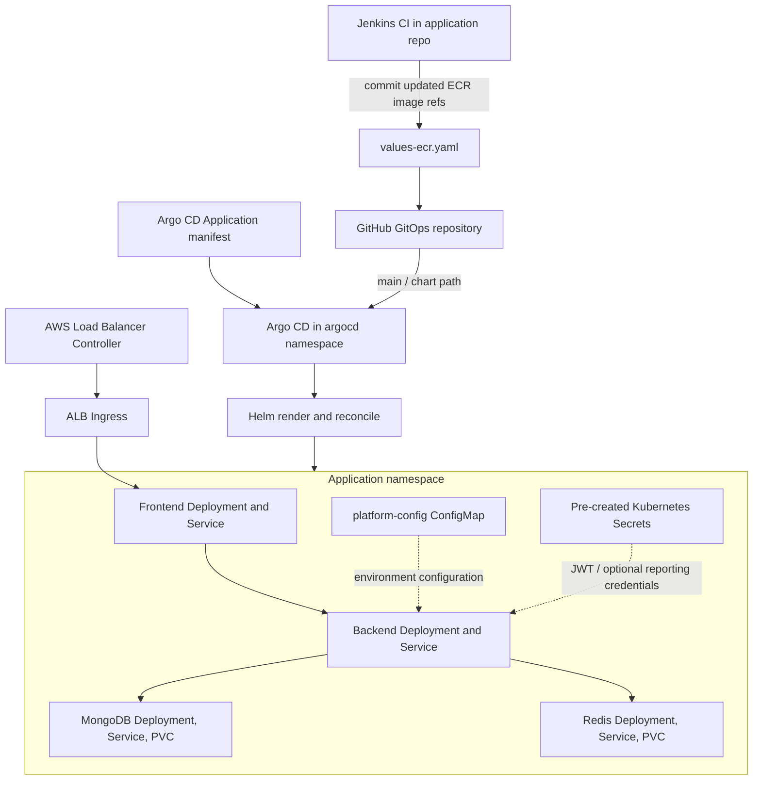

# GitOps repository architecture

This repository is the deployment source of truth for the application Helm chart. Jenkins updates the image values on successful `main`-branch publication; Argo CD observes Git and reconciles the chart into EKS.

## Reconciliation policy

The Argo CD Application uses automated sync and self-heal, creates the destination namespace when needed, and sets `prune: false`. This means changes in Git are reconciled, but resources removed from Git are not automatically deleted by pruning.

## Runtime dependencies

The chart assumes the EKS cluster, ECR images, storage class/EBS CSI support, required Kubernetes secrets, and (if ingress is enabled) the AWS Load Balancer Controller already exist. Those dependencies are created outside this repository.
